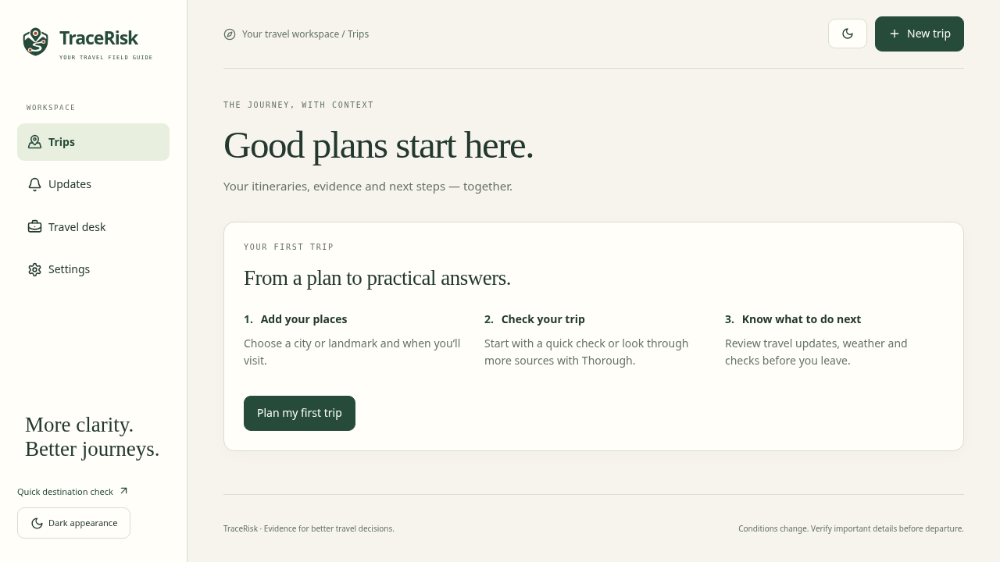
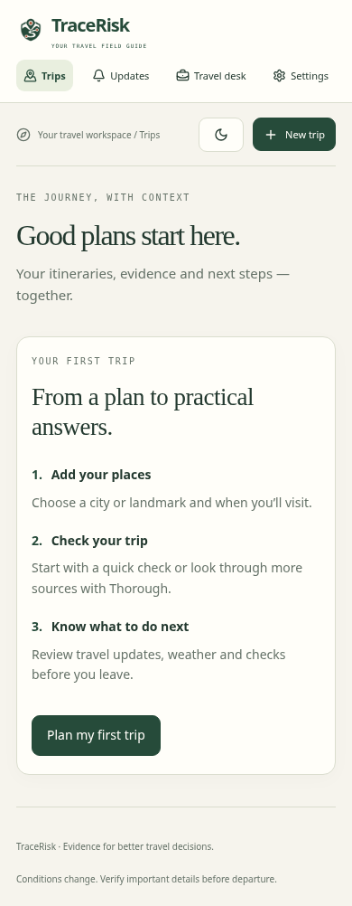

# TraceRisk

**Plan your trip. Understand what could affect it. Know what to check next.**

[](https://github.com/codeby-irFAN/TraceRisk/actions/workflows/ci.yml)

TraceRisk brings travel updates, weather, route information and original sources into one workspace for trips in India. Plan a city visit or a multi-stop journey, check for disruptions, and share a simple briefing.

[Open TraceRisk](https://tracerisk.onrender.com/) · [User guide](docs/USER_GUIDE.md) · [Setup](#run-locally) · [Azinhack brief](AZINHACK_SUBMISSION.md)

## Start with three steps

1. **Add your places.** Create an account, select **New trip**, enter a city or landmark, choose **Find place**, and select the correct match. Add your dates and travel mode, then save. Examples: **Hawa Mahal, Jaipur** and **Qutub Minar, Delhi**.
2. **Check your trip.** Choose **Quick** for a short check or **Thorough** to look through more sources. Progress appears while the check runs; you can cancel and keep your previous completed report.
3. **Review your next steps.** Read travel updates, weather and practical departure checks. Open **Evidence** for original sources, or **Share** for a briefing link or printable PDF.

The first visit includes a short guide. Place confirmation, date validation, keyboard-accessible forms and clear save messages help users finish planning. Empty searches offer **Clear search**, and watch labels show whether automatic checks are actually available.

> TraceRisk supports travel decisions. It is not an official safety rating or emergency service. No disruptions found means none were established in the information checked; verify important details before departure.

## What you can do

| Feature                   | How it helps                                                                                                                         |
| ------------------------- | ------------------------------------------------------------------------------------------------------------------------------------ |
| Multi-stop planning       | Save up to six confirmed cities or landmarks, with dates for each stop. Add an origin for route checks.                              |
| Quick and Thorough checks | Collect recent reports, forecasts, source links and practical checks with visible progress and cancellation.                         |
| Route map                 | View road geometry, supported alternatives and source-supported event locations. Broader reports appear separately.                  |
| Trip Watch                | Check saved trips every 1, 3, 6, 12 or 24 hours when the server is running and monitoring is enabled. Review changes in **Updates**. |
| Alternative comparison    | Recheck a supported road option or shift dates by up to seven days without editing your saved plan.                                  |
| Evidence panel            | Inspect quotations, event dates, affected areas, supporting sources, conflicting reports and collection times.                       |
| Personal guidance         | Select travel mode and optional needs such as children, limited mobility or air-quality sensitivity.                                 |
| Trip assistant            | Ask about the saved trip’s disruptions, weather or next steps, with citations to the retrieved evidence.                             |
| Travel desk               | Manage client trips, add agency branding, and create printable or shareable briefings.                                               |

Trips are private to the signed-in account. Public briefing links are frozen copies that expire after seven days and can be revoked. Client/group names are omitted unless selected. Trip Watch alerts appear **inside the workspace**; email, SMS and push alerts are not implemented.

The original single-destination checker is still at [`/check`](https://tracerisk.onrender.com/check), with a browser notebook and text export. Its notebook and theme preferences stay in that browser; account trips are saved on the server.

## Interface preview



<details>
<summary>Mobile guide and client travel desk</summary>




</details>

Screenshots use browser-test fixtures. They do not show current travel conditions or prove live provider availability.

## Run locally

Use **Node.js 24 or newer**. Node’s built-in SQLite supports local accounts without a database service.

```sh
git clone https://github.com/codeby-irFAN/TraceRisk.git
cd TraceRisk
npm ci
```

Copy `.env.example` to `.env` once; preserve an existing file:

```sh
# macOS / Linux
cp -n .env.example .env
```

```powershell
# Windows PowerShell
if (!(Test-Path .env)) { Copy-Item .env.example .env }
```

| Setting                                                                       | Purpose                                                                                                                     |
| ----------------------------------------------------------------------------- | --------------------------------------------------------------------------------------------------------------------------- |
| `TINYFISH_API_KEY`                                                            | Web search and full-page extraction. Thorough can still retrieve independent news leads without it.                         |
| `GROQ_API_KEY`                                                                | Optional AI quotation selection. Groq is the only supported AI provider; deterministic checks work without it.              |
| `SUPABASE_URL`, `SUPABASE_PUBLISHABLE_KEY`, `SUPABASE_SECRET_KEY`, `SITE_URL` | Optional cloud authentication and PostgreSQL storage. Configure together using the setup guide. Otherwise use local SQLite. |

Keep credentials in local or hosting settings. Never commit `.env` or put server secrets in `VITE_` variables. Public map tiles and default place/weather services do not need an API key; provider terms and availability still apply.

```sh
npm run dev
```

Open `http://127.0.0.1:5173`. Express defaults to port `8787`; Vite proxies `/api` requests. Create a local account and follow the three steps above. Stop with `Ctrl+C`.

For a production build, run `npm run build` then `npm run server`; Express serves the built frontend. [Deployment settings](docs/DEPLOYMENT.md) explain hosting, providers and persistent storage.

## Cloud accounts, Google login and maps

- **Supabase:** follow [the setup guide](docs/SUPABASE_SETUP.md) to apply the SQL migration and configure Render. Supabase Auth manages accounts; private PostgreSQL storage holds trips, timelines and briefing snapshots. Local accounts are separate; the guide includes an optional reviewed import process.
- **Google login:** enable the Google provider using [these steps](docs/GOOGLE_SIGN_IN.md). Enter the Google client secret directly in Supabase. The Google button is available in Supabase mode; email/password remains an option.
- **Map:** the default OpenStreetMap background needs no key. Custom providers use `VITE_MAP_TILE_URL` and `VITE_MAP_ATTRIBUTION` at build time. Tile failures retain the route/markers and show an external map link. Remove old CARTO overrides that display “API key required”.
- **Trip Watch:** needs an available server and persistent data. Supabase preserves trips across redeployments but does not keep Render Free awake. If monitoring is disabled, the interface shows manual checks instead.

**Existing Supabase installations:** re-run the current [SQL migration](supabase/migrations/202610230001_tracerisk.sql) before Thorough checks to enable the longer scan lease. It preserves existing trips. A GitHub push alone does not apply database migrations or change hosting settings.

## How checks work

Quick checks have a processing budget of about **20 seconds per place**, with a full-trip limit of **110 seconds**. Thorough checks retrieve fresh evidence, consider up to **28 candidate pages per place**, allow **90 seconds per place**, and cap the itinerary at **eight minutes**. Either can finish sooner; hosting cold starts and network delays add time. Scheduled checks use Quick; comparisons use the saved report’s check type.

The server resolves places, searches for relevant reports, opens selected pages, checks quotations against the text, and matches findings to the place and dates. Weather and other structured signals supplement the report. Thorough also tries independent Google News RSS and GDELT discovery. Optional Groq selects quotations; it cannot invent the displayed evidence or set scores. Successfully retrieved information survives other provider failures.

Headlines and snippets remain leads until verified against page text. Extra scan time cannot guarantee that a source exists or is reachable. With no established disruption, the report still offers available forecasts, source leads and useful departure checks. [Engineering decisions](DECISIONS.md) explain verification and limits; [evaluation](docs/EVALUATION.md) separates fixture tests from live measurements.

## Development

```sh
npm test
npm run format:check
npm run build
npx playwright install chromium
npm run test:browser
```

Browser tests use the built app on port `4174`. Tests use fixtures and need no provider keys. SQL tests run the actual Supabase migration in embedded PostgreSQL. [GitHub Actions](.github/workflows/ci.yml) runs the checks on pushes and pull requests. See [Contributing](CONTRIBUTING.md) for browser setup and documentation formatting.

Live retrieval checks consume provider quota and run separately: `npm run benchmark:live -- --live`.

## Project structure

| Path                                               | Responsibility                                                         |
| -------------------------------------------------- | ---------------------------------------------------------------------- |
| `src/trips/`                                       | Account screens, trip planning, workspace, reports, map and briefings. |
| `src/QuickCheck.jsx`, `src/components/`            | Single-destination checker, notebook and exports.                      |
| `server/trip-api.js`, `server/trip-service.js`     | Trip endpoints, scheduled checks and jobs.                             |
| `server/auth.js`, `server/supabase-auth.js`        | Local and Supabase authentication.                                     |
| `server/trip-store.js`, `server/supabase-store.js` | SQLite and Supabase persistence.                                       |
| `server/analyze.js`, `server/evidence.js`          | Evidence collection and verification.                                  |
| `supabase/migrations/`                             | Private database schema and ownership-checked functions.               |
| `tests/`, `e2e/`                                   | Backend, database and browser regressions.                             |

## Limits worth understanding

News indexing, local-language coverage, source access and forecasts can be incomplete. A landmark check may use surrounding-city reports; that does not establish a closure at the attraction. Opening hours and ticket prices need supporting evidence. Driving estimates exclude live traffic and closures; train/flight routing and timetables are unsupported. Corridor checks sample up to two areas, not every road segment.

A disappearing report remains unconfirmed until a current source supports resolution. Evidence support is not a safety probability; no independently measured accuracy percentage is claimed. Public provider limits, hosting availability and process-local job/rate-limit state also constrain production use. Commercial weather terms must be reviewed before an ad-funded launch.

## Documentation

[User guide and FAQ](docs/USER_GUIDE.md) · [API](docs/API.md) · [Deployment](docs/DEPLOYMENT.md) · [Supabase](docs/SUPABASE_SETUP.md) · [Google login](docs/GOOGLE_SIGN_IN.md) · [Decisions](DECISIONS.md) · [Evaluation](docs/EVALUATION.md) · [Contributing](CONTRIBUTING.md) · [Azinhack brief](AZINHACK_SUBMISSION.md)
