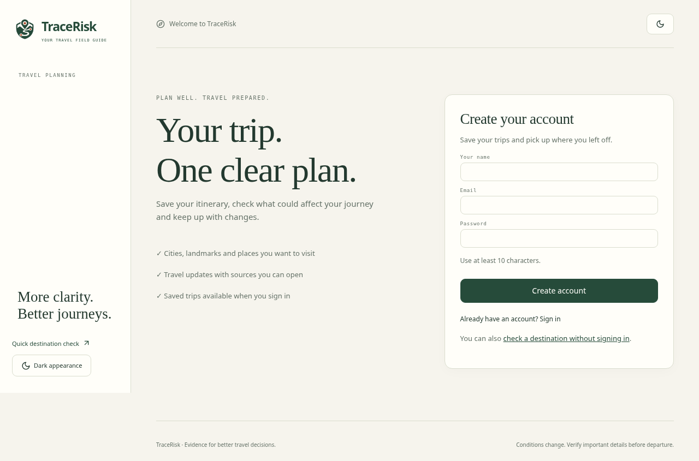
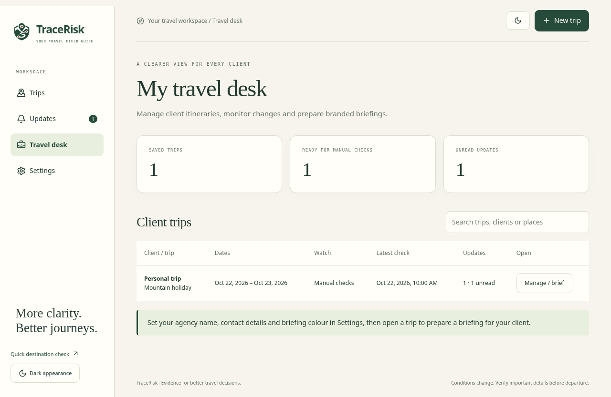
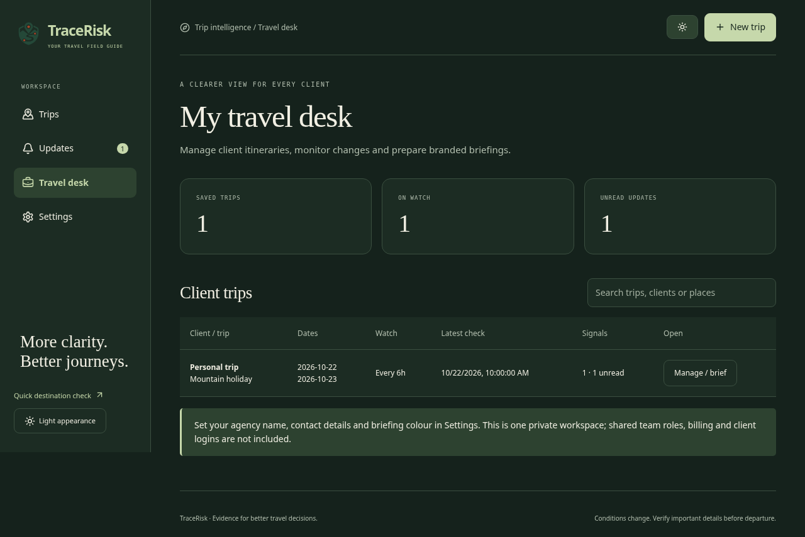
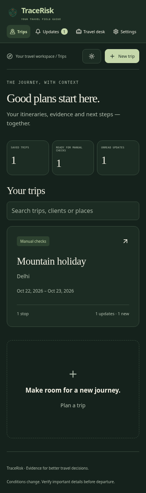
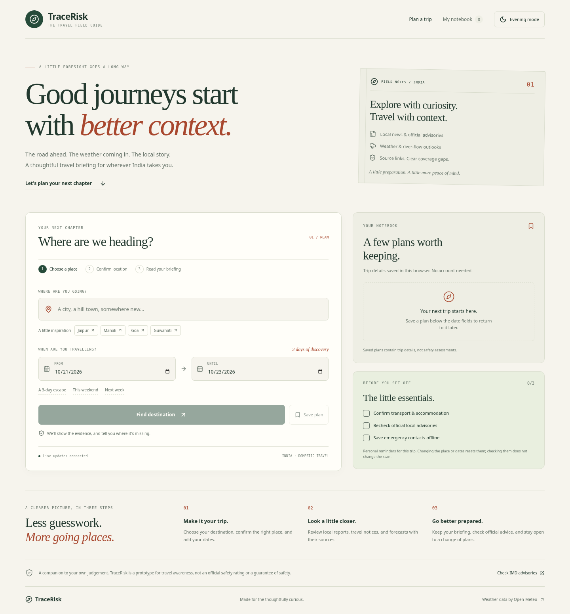
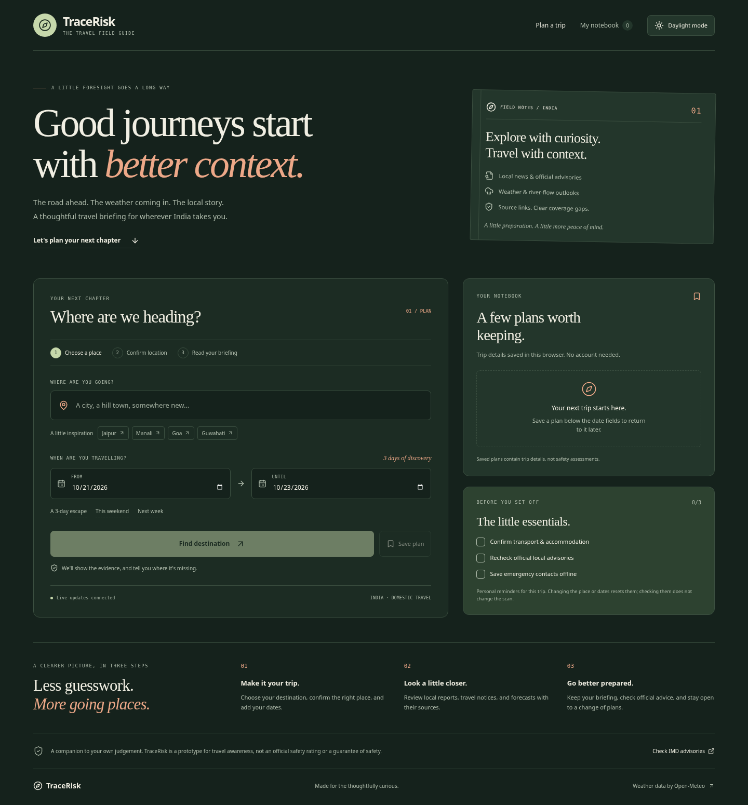
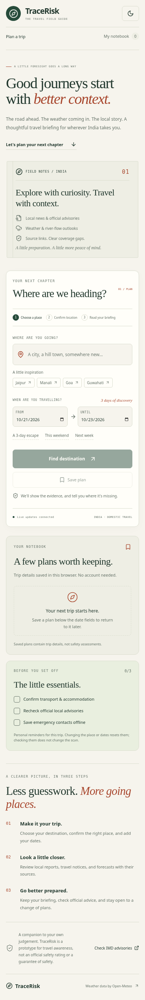

# TraceRisk

**The travel field guide for India.**

[](https://github.com/codeby-irFAN/TraceRisk/actions/workflows/ci.yml)

TraceRisk follows an Indian trip from planning to departure: dated stops, road corridors, source-linked evidence, scheduled change checks and branded briefings. The trip workspace is at `/`; the original destination checker remains at `/check`.

> TraceRisk is a prototype for travel awareness, not an official safety rating, emergency service, or guarantee of safety. Confirm important conditions with official authorities and transport operators.

[Demo recording](https://drive.google.com/file/d/1RIJOVODbjnc7rzDPaioiRQqtznZLq5oE/view?usp=drivesdk) · [Engineering decisions](DECISIONS.md) · [API](docs/API.md) · [Deployment](docs/DEPLOYMENT.md) · [Evaluation](docs/EVALUATION.md) · [Contributing](CONTRIBUTING.md) · [Azinhack brief](AZINHACK_SUBMISSION.md)

Use this README for the current workflow; the recording is a separate demonstration.

## What you can do

| Feature                    | Working behaviour                                                                                                                                                                                             |
| -------------------------- | ------------------------------------------------------------------------------------------------------------------------------------------------------------------------------------------------------------- |
| Route-aware disruption map | Confirm an origin and stops, display OSRM road geometry and alternatives, and check up to two intermediate areas. Source-supported coordinates get incident markers; broader reports stay in a regional list. |
| Trip Watch                 | Save up to 50 trips in a private workspace. Server checks every 1, 3, 6, 12 or 24 hours until trip end and records meaningful in-app alerts. Pause, resume, filter alerts and mark updates read.              |
| Alternative comparison     | Recheck a supported road option and/or shift the itinerary by 0–7 days. Compare dated evidence, weather coverage and estimated driving time without changing the saved plan.                                  |
| Multi-city itinerary       | Add up to six confirmed stops, each with arrival/departure dates, in a combined itinerary and report timeline.                                                                                                |
| Evidence verification      | Inspect quotations, original links, event-date basis, affected area, publisher support, possible conflicting reports and last verification time.                                                              |
| Personal impact            | Choose car, bus, motorcycle, train or flight; add children, limited mobility and air-quality needs for practical guidance.                                                                                    |
| Travel-agent desk          | Filter client trips, monitor watch status and unread updates, configure agency branding and generate printable, shareable briefings.                                                                          |

The evidence-grounded trip assistant explains transport, weather, departure checks and recorded changes using saved evidence and source citations. It explicitly identifies missing information. Quick Check still offers its browser notebook, date shortcuts, text export and source filters.

Create a free account with your name, email and password, then add an itinerary and run a check. Sign in on another device to see the same trips. Passwords are salted and hashed; sign-in uses an HttpOnly session cookie, with no recovery key to copy or store. Existing key-based trips transfer automatically when an account is created in the same browser; signing in to an existing account can also import unclaimed browser trips. Public briefing links expire after seven days, can be revoked, and omit the client name unless selected.

Stops can be cities or attractions such as **Hawa Mahal, Jaipur** or **Qutub Minar, Delhi**. The app preserves landmark coordinates and checks the surrounding city for relevant travel updates; a city report is not automatically a closure at the attraction. A small built-in landmark directory works without a geocoding key; broader searches use Photon/OpenStreetMap and city geocoding. Opening hours and ticket prices are only answered when retrieved evidence supports them.

The main results use plain-language summaries. Source methodology and route limitations stay available in expandable details. Comparisons show actual weather and travel updates, and omit missing driving times rather than displaying an invalid estimate. The map uses the standard OpenStreetMap background without an API key and keeps route/stop overlays available if tiles fail to load.

Trip Watch alerts appear **inside the workspace**, including changes collected while the browser was closed. There is no email, SMS or operating-system push delivery. The server must remain running with persistent storage for reliable monitoring.

No established disruption still produces a useful plan: dated forecasts where available, source leads, explicit coverage by information type and practical departure checks. Missing evidence never becomes an invented safe verdict. A disappearing report is labelled “not observed”; only an explicit recent reopening/withdrawal report supports “resolved”.

Road routing uses driving estimates, excludes live traffic/closures and does not provide bus timetables. Train/flight routes and ETA are unsupported; their stop evidence and operator checks remain available. Corridor checks sample at most two areas using their leg’s travel dates; they do not continuously verify every road segment. Alternative routes are supplied only when the routing provider returns them (normally a two-point road journey).

Weather/flood forecasts, modelled US AQI and nearby orange/red GDACS alerts supplement retrieved reports. Forecast windows and provider failures remain visible. Evidence support is not a calibrated safety probability. Publication-grade accuracy and an 80–90% decision rate have **not** been established by independent evaluation.

The visual theme uses flat ivory, forest green, and terracotta surfaces, with a generated map-pin and route emblem shared by the header, footer and favicon. The frontend uses React 19, Vite 7, Lucide icons, and CSS transitions; the backend uses Express 5 on Node.js.

## Trip workspace preview



Illustrative fixture data from browser tests; these screenshots do not show live travel conditions.



<details><summary>Dark and mobile workspace</summary>





</details>

<details>
<summary>View the current interface</summary>

Quick Check interface previews (the legacy `/check` view), not evidence of a successful live provider scan. Connection indicators are illustrative.

### Daylight



### Evening



### Mobile



</details>

## Run locally

Use **Node.js 24** for the same major version as CI. Node.js **24 or newer is required** for the built-in SQLite database. Run these commands from the repository root:

```sh
git clone https://github.com/codeby-irFAN/TraceRisk.git
cd TraceRisk
npm ci
```

Copy the configuration template once, preserving any existing `.env`:

```sh
# macOS / Linux
cp -n .env.example .env
```

```powershell
# Windows PowerShell
if (!(Test-Path .env)) { Copy-Item .env.example .env }
```

Edit `.env` before starting:

| Setting            | Needed for                                                                          |
| ------------------ | ----------------------------------------------------------------------------------- |
| `TINYFISH_API_KEY` | Live search and webpage extraction; without it, weather and next checks still work. |
| `GROQ_API_KEY`     | Optional AI quotation selection; the only supported AI provider.                    |
| `GROQ_MODEL`       | Optional model overrides; see [configuration](docs/DEPLOYMENT.md#configuration).    |

Replace required placeholders with valid credentials. Leave unused optional credentials blank; known placeholder values are treated as missing. Configuration flags still do not validate real credentials. Get keys through [TinyFish](https://agent.tinyfish.ai/), [Groq Console](https://console.groq.com/keys). Keep real credentials in local or deployment settings, never in Git.

City lookup uses Open-Meteo geocoding; landmark lookup also uses a small bundled directory and Photon/OpenStreetMap. Its public non-commercial geocoding, forecast, and flood endpoints do not require an API key. The optional external proxy is described in the [deployment guide](docs/DEPLOYMENT.md#optional-cloudflare-worker-proxy).

```sh
npm run dev
```

The frontend starts at `http://127.0.0.1:5173`; Express defaults to port `8787`. Vite forwards `/api` requests to the backend and follows a custom `PORT` setting. Backend watch mode and Vite reload development changes. Stop both with `Ctrl+C`.

1. Enter a destination and travel dates; shortcuts fill the form without starting a request.
2. Select **Find destination**, then choose the correct location.
3. Select **Check my trip**. The backend has a 20-second processing budget; slow providers yield partial results. Hosting cold starts and network time are additional. **Cancel scan** stops waiting.
4. Read the source-coverage warning, findings, weather gaps, and supporting links.
5. Download the complete briefing or print the current view. Recheck official information close to departure.

`GET /api/health` reports server configuration without returning keys. Configuration flags do not validate credentials, quota, model availability, or upstream connectivity.

## How collection and assessment work

```text
Trip planner
  ├── GET /api/locations → user confirms a server-resolved place
  └── POST /api/analyze → request limits, shared work, and short-lived cache
       ├── 8 TinyFish search lanes + broader retry where appropriate
       ├── Open-Meteo forecasts for the confirmed coordinates
       ├── Deduplicate and select up to 12 relevant webpages
       ├── Extract each page independently in parallel
       ├── Optional Groq quotation selection + deterministic evidence checks
       └── Checked quotations + useful source leads + forecasts + next checks
```

Source-supported findings require fetched text, a matching place and date evidence. AI cannot invent the displayed facts or choose their scores. Groq is the only AI provider. It is optional: deterministic evidence checks remain available when its key is missing or a request fails. Weather thresholds supplement the assessment. Default model identifiers are implementation settings, not a guarantee that a provider currently offers them to every account.

Collection status is `adequate`, `limited`, or `inconclusive`. These describe evidence coverage, not destination safety. A score of zero or an empty issue list is not an all-clear. The heuristic overall score and its limitations are explained in [DECISIONS.md](DECISIONS.md#risk-scoring).

By default, scan protection allows six requests per client IP per ten minutes and three distinct concurrent scans per Node process. Identical requests can share provider work, and completed results are cached for 60 seconds. These controls, including proxy/IP assumptions and multi-instance limitations, are detailed in [deployment](docs/DEPLOYMENT.md#request-limits-and-process-state).

## Development and checks

```sh
npm test
npm run format:check
npm run build
npx playwright install chromium
npm run test:browser
```

Run the build before browser tests; they use the built frontend and a local server on port `4174`. Tests use provider fixtures and do not require live API credentials. They cover backend validation and fallback, cancellations and shared scans, weather date matching, saved plans, themes, filters, exports, and mobile layouts. They do not establish that a live provider account or deployed environment works.

[GitHub Actions](.github/workflows/ci.yml) runs these checks on pushes and pull requests. See [CONTRIBUTING.md](CONTRIBUTING.md) for scripts, browser setup, and change-specific validation.

To measure real provider performance separately from fixture tests:

```sh
npm run benchmark:live -- --live
```

This uses configured provider quota and writes ignored reports under `artifacts/benchmarks/`. See [evaluation](docs/EVALUATION.md) for measured examples and what they do not prove. Groq was not live-tested in this environment because its credential was not configured.

## Repository map

| Location                                                           | Responsibility                                                              |
| ------------------------------------------------------------------ | --------------------------------------------------------------------------- |
| `src/App.jsx`                                                      | Planning workflow, API requests, cancellation, and theme coordination.      |
| `src/components/`                                                  | Notebook, results, evidence filters, issues, weather, and location choices. |
| `src/planning.js`, `src/hooks/useStoredState.js`                   | Plan/date helpers, text export, and browser persistence.                    |
| `server/app.js`, `server/index.js`                                 | HTTP routes, static serving, and server startup.                            |
| `server/analyze.js`                                                | Collection, assessment, and coverage orchestration.                         |
| `server/search.js`, `server/evidence.js`, `server/assessment.js`   | Retrieval, source/quotation verification and optional AI selection.         |
| `server/locations.js`, `server/weather.js`, `server/open-meteo.js` | Confirmed places, forecast signals, and weather transport/cache.            |
| `server/scan-manager.js`, `server/http.js`                         | Rate limits, shared jobs, time budgets, retries, and cancellation.          |
| `tests/`, `e2e/`                                                   | Node regression tests and Playwright browser tests.                         |

## Limitations

Search can miss new, local-language, social-only, or poorly indexed reports. Publication dates, extracted pages, and AI conclusions may be incomplete or wrong. Broader search can return background material; a government-domain badge does not establish that an advisory is current. Forecasts are model-derived, date-limited, and may not represent local conditions or a particular river or route.

Saved plans, theme preferences, and checklist items stay in the current browser; they are not account-synced or guaranteed to survive cleared storage. Server quotas and caches are in memory, not shared between replicas. Travel details and selected evidence are sent to the relevant providers to perform a scan; see the [data-handling decisions](DECISIONS.md#data-handling-and-credentials).

TraceRisk remains a prototype. Use official authorities, emergency services, and transport operators for time-critical decisions.

## Supabase cloud accounts and storage

Supabase Auth/Postgres integration is available alongside local SQLite mode. Follow the [project-specific Supabase setup guide](docs/SUPABASE_SETUP.md) to apply the SQL migration and add the Render environment settings. The guide includes your project URL and public key, email-confirmation/reset redirects, the server-only secret setting and a read-only SQLite-to-Supabase trip migration tool.

The integration uses private ownership-checked storage, HttpOnly PKCE sessions and server-only writes for generated reports. Old local accounts are separate; users register/confirm a Supabase account, and existing trips can be transferred using an explicitly reviewed mapping. A code push alone does not create tables or change the Render environment. Supabase stores data across redeployments; it does not keep Render Free awake for scheduled checks.
